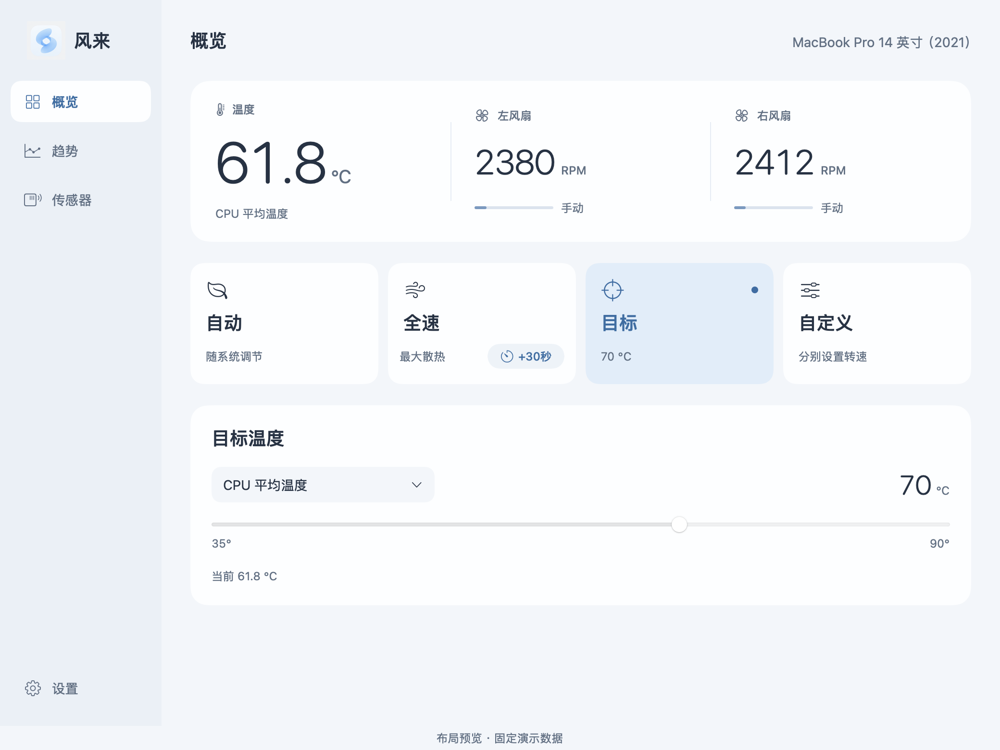

# 风来

免费的 macOS 温度监测与风扇控制工具。

温度与转速一目了然；需要时，切换到目标温度、自定义转速或临时全速。关闭主窗口后，风来继续在菜单栏运行。



## 下载

在[最新版本](https://github.com/zongkai16/fenglai-releases/releases/latest)中下载 `Fenglai-1.0-universal.pkg`。

- 主应用需要 macOS 13 或更高版本；桌面小组件需要 macOS 14 或更高版本。
- Universal 安装包同时包含 Apple 芯片和 Intel 两种架构。
- 无风扇设备保留监测功能，调速入口不可用。
- 已记录的硬件调速与恢复验收来自 MacBook Pro 14 英寸（2021，M1 Pro）；Intel 和其他机型仍需分别验证。

安装包和使用说明免费提供，源码由作者保留。无需注册产品账号或购买授权。

## 安装与使用

1. 下载 PKG 和同版本的 `SHA256SUMS.txt`。在下载目录运行 `shasum -a 256 Fenglai-1.0-universal.pkg`，将结果与校验表中 PKG 对应行比较。
2. 打开 PKG，按 macOS 安装向导安装。安装时需要有正常登录的桌面用户，管理员身份验证由系统处理。
3. 从“应用程序”打开“风来”，首次使用从“自动”模式开始。
4. 需要桌面小组件时，在 macOS 小组件库中添加“风来”。

当前安装包尚未使用 Developer ID 签名和 Apple 公证，适合愿意反馈问题的用户试用。macOS 可能阻止首次安装或打开；请确认下载来源和文件校验值，再使用系统“隐私与安全性”中的允许入口。保留系统安全保护。

推荐使用 PKG 安装和更新。ZIP 仅包含应用，不会自动安装控制服务或执行完整升级流程。

## 功能

- **自动**：由 macOS 管理风扇。
- **目标**：根据选定传感器与目标温度调整散热；实际温度受负载和散热能力影响。
- **自定义**：分别设置每只风扇的转速。
- **临时全速**：每次增加 30 秒全速运行，到时恢复自动。
- **趋势**：查看本机保存的温度和转速历史。
- **登录时启动**：在设置中开启，按 macOS 要求完成授权，后续登录时于菜单栏后台运行。
- **更新检查**：默认每次启动时后台检查新版，可在设置中关闭；发现更新后由用户确认下载安装。

小组件刷新由 WidgetKit 调度，请以主窗口作为实时观察入口。完全退出、休眠或控制连接中断时，控制服务会尝试恢复系统自动并检查结果。

## 卸载与反馈

先在设置中关闭“登录时启动”，从菜单栏选择“完全退出”，再运行：

```sh
"/Applications/风来.app/Contents/Resources/uninstall-helper.command"
```

确认控制服务卸载完成后，将应用移入废纸篓。恢复自动尚未确认时，卸载会停止并保留相关组件。

使用问题请到 [Issues](https://github.com/zongkai16/fenglai-releases/issues) 反馈，注明风来版本、macOS 版本、机型与错误提示。请勿公开序列号、密码或未经检查的整机日志。

详见[数据、权限与故障排查](docs/privacy-and-support.md)、[免费分发许可](LICENSE)和[第三方许可](THIRD_PARTY_NOTICES.md)。
